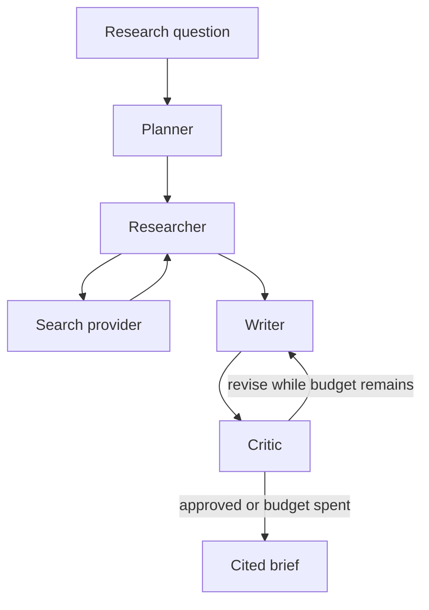

# Multi-Agent Research Assistant

A small research assistant that takes a question and returns a cited brief. A planner splits the question, a researcher gathers sources, a writer drafts the brief, and a critic checks the citations. The critic can send the draft back to the writer once.

The default LLM and search providers are deterministic mocks. The API, the UI, the tests, and the eval harness run with no API keys. Set an environment variable to switch the model to OpenAI GPT-4o or Anthropic Claude, and the search provider to Tavily.

## Architecture



The Next.js app posts the question to FastAPI. The API runs the LangGraph pipeline and streams each step over server-sent events. The page shows the plan, the sources, and the brief. Optional pasted notes are added as a local source.

More detail is in [docs/architecture.md](docs/architecture.md).

## Quickstart

Requires Python 3.11+ and Node.js 22.

```bash
python3 -m venv .venv
source .venv/bin/activate
make install
```

In one terminal:

```bash
make dev-api
```

In another:

```bash
make dev-web
```

Open [http://localhost:3000](http://localhost:3000). The API is at [http://localhost:8000](http://localhost:8000). `GET /health` reports which providers are active, and `GET /docs` is the generated OpenAPI page.

The example questions in the UI match the local mock corpus.

### Docker Compose

```bash
docker compose up --build
```

The web app is published on port 3000 and the API on port 8000. Compose reads a `.env` file in this directory when you have one, and otherwise starts the mock providers.

```bash
cp .env.example .env
# edit keys only if you want a hosted model or live search
docker compose up --build
```

## Configuration

Copy `.env.example` to `.env`. The file in git has empty secrets. Do not commit real keys.

| Variable | Default | Purpose |
| --- | --- | --- |
| `LLM_PROVIDER` | `mock` | `mock`, `openai`, or `anthropic`. |
| `OPENAI_API_KEY` | empty | Required when `LLM_PROVIDER=openai`. |
| `OPENAI_MODEL` | `gpt-4o` | OpenAI chat model. |
| `ANTHROPIC_API_KEY` | empty | Required when `LLM_PROVIDER=anthropic`. |
| `ANTHROPIC_MODEL` | `claude-sonnet-5-5` | Anthropic Claude model id. |
| `SEARCH_PROVIDER` | `mock` | `mock` or `tavily`. |
| `TAVILY_API_KEY` | empty | Required when `SEARCH_PROVIDER=tavily`. |
| `MAX_REVISIONS` | `1` | How many times the critic may send the brief back to the writer. Capped at 3. |
| `SEARCH_RESULTS_PER_QUERY` | `3` | Search hits kept per sub-question before de-duplication. |
| `CORS_ORIGINS` | `http://localhost:3000` | Comma-separated browser origins. |
| `NEXT_PUBLIC_API_URL` | `http://localhost:8000` | API URL the browser calls. Baked in when the web app is built. |

`LLM_PROVIDER=openai` or `anthropic` without the matching key fails at startup with a configuration error. The mock path does not call those SDKs.

## Evals

```bash
make eval
```

The harness runs the questions in `evals/golden_questions.json` through the graph and prints two scores:

- **Topic coverage:** fraction of the case's expected strings that appear in the brief. This is a case-insensitive substring check, not a judgment that the sentence is right.
- **Citation resolution:** fraction of numeric markers such as `[1]` that point at a source the run actually retrieved.

On the default mock providers, a case fails the process when the combined score is under that case's `min_score`, a marker does not resolve, or there are fewer distinct citations than `min_citations`. That guard is a regression check for the offline stack. With a hosted model the script still prints scores and does not apply the guard. This repository does not publish benchmark results.

## Tests and CI

```bash
make lint
make test
make typecheck
make build
```

`make ci` runs those targets plus `make eval`. GitHub Actions runs the same checks on pull requests: Ruff, pytest, the eval harness, ESLint, `tsc`, the web unit tests, and `next build`.

## Project structure

```
apps/api/                 FastAPI app, LangGraph pipeline, providers, pytest
apps/web/                 Next.js UI
evals/                    Golden questions, metrics, and the eval script
docs/architecture.md      State, providers, and v1 limits
docker-compose.yml        API and web
Makefile                  Install, dev, test, eval, compose
.github/workflows/ci.yml  Lint, test, typecheck, and build
```

## Roadmap

v1 is a single-process demo.

- Persist runs and keep a history across restarts.
- Upload files, not only pasted notes.
- Add search providers besides the local corpus and Tavily.
- Let a person approve the plan before research starts.
- Judge whether a citation supports the sentence, which the current citation-resolution check does not do.

Authentication, multi-tenant hosting, and a large crawl pipeline are out of scope.

## License

[MIT](LICENSE). Copyright (c) 2026 Martin Couso.
