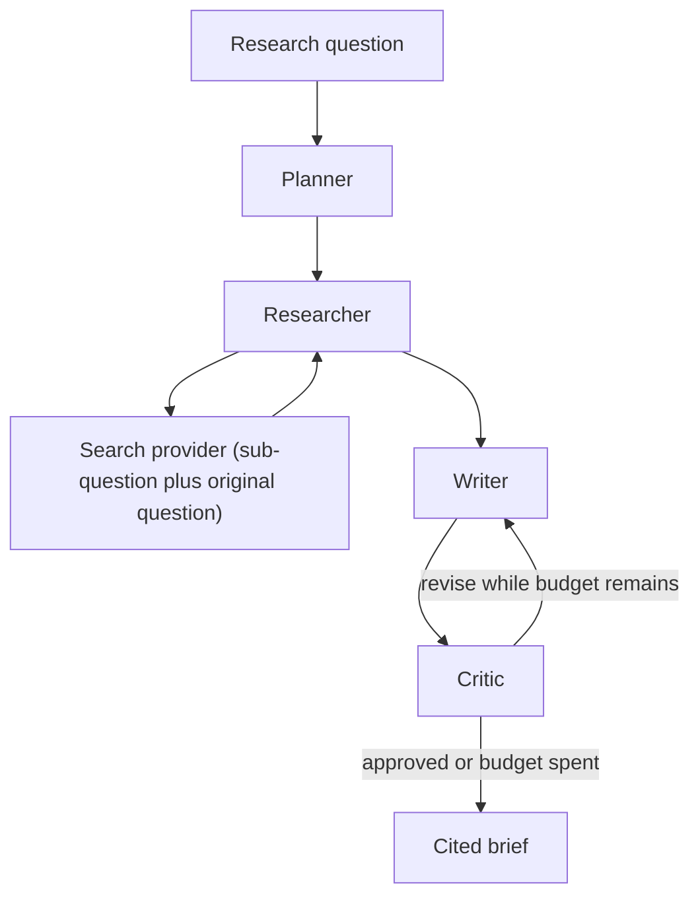

# Architecture

The assistant is one LangGraph pipeline behind a FastAPI service. The Next.js app submits a question and renders server-sent events as each node finishes.

## Graph

Shared state:

| Field | Role |
| --- | --- |
| `question`, `notes` | The user question and optional pasted notes. |
| `sub_questions` | Planner output. Each item has an id and text. |
| `sources` | Deduped search hits, plus notes when present. Citation numbers match list order. |
| `findings` | Researcher claims. Each claim points at one or more source ids. |
| `report_markdown` | The current brief. |
| `critique` | Critic verdict, issues, and revision instructions. |
| `revision_count` | How many times the writer has already revised. |
| `trace` | Append-only steps streamed to the UI. |

Routing after the critic:

- Approved briefs stop.
- Unapproved briefs return to the writer while `revision_count < max_revisions`.
- When the budget is spent, the latest brief is returned with the critic's verdict attached. The API does not hide an unapproved result.

`MAX_REVISIONS` defaults to 1 and is capped at 3 so a hosted model cannot loop indefinitely.

## Providers

Nodes call a small `complete(system, user)` interface. They do not import a vendor SDK.

| `LLM_PROVIDER` | Behavior |
| --- | --- |
| `mock` (default) | Deterministic responses derived from the JSON payload. No network. |
| `openai` | Chat Completions. Default model `gpt-4o`. Requires `OPENAI_API_KEY`. |
| `anthropic` | Messages API. Default model `claude-sonnet-5-5`. Requires `ANTHROPIC_API_KEY`. Override with `ANTHROPIC_MODEL`. |

| `SEARCH_PROVIDER` | Behavior |
| --- | --- |
| `mock` (default) | Keyword match over a fixed local corpus. Unmatched queries get a deterministic fallback that does not invent outside facts. |
| `tavily` | Live web search. Requires `TAVILY_API_KEY`. |

The mock critic approves a brief when every numeric citation resolves to a retrieved source. Hosted critics receive the same structural result and are asked to judge whether the sub-questions are actually covered. Structural failure always blocks approval.

Pasted notes become a source with url `local://notes`. Mock corpus urls use the `mock://` scheme so they are not presented as live pages.

## API

- `GET /health` reports the configured providers.
- `POST /api/research` runs the graph and returns the brief.
- `POST /api/research/stream` emits `step`, `report`, `done`, or `error` events as `text/event-stream`.

Runs are not stored. Restarting the process drops nothing the client has not already received, because there is no run history in v1.

## Evals

`evals/run_eval.py` sends `evals/golden_questions.json` through the same graph.

- Topic coverage is the fraction of expected strings found in the brief, case-insensitive. A hit does not mean the sentence is correct.
- Citation resolution is the fraction of `[n]` markers that point at a source in the returned list.
- The pass/fail guard runs only for the mock providers. It is a regression check for this harness. Hosted providers are scored and printed without that guard.

## v1 limits

- One process, no authentication, no persisted runs.
- The local corpus is a handful of entries for the demo and the golden set.
- Citation resolution does not prove a source supports the claim. The critic is the place that judgment is requested, and in mock mode that judgment is only the structural check.
